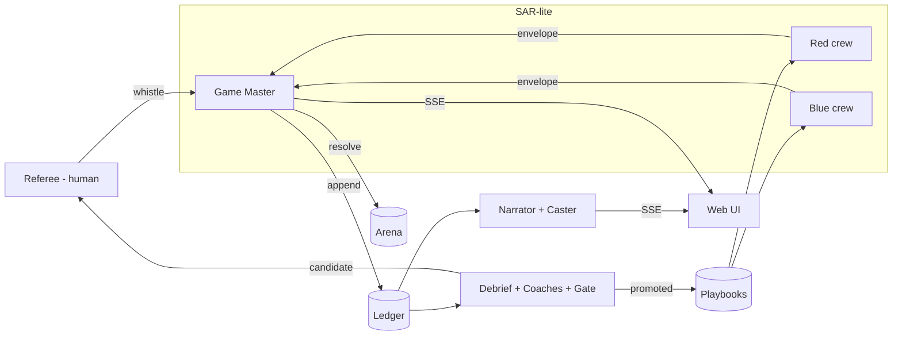
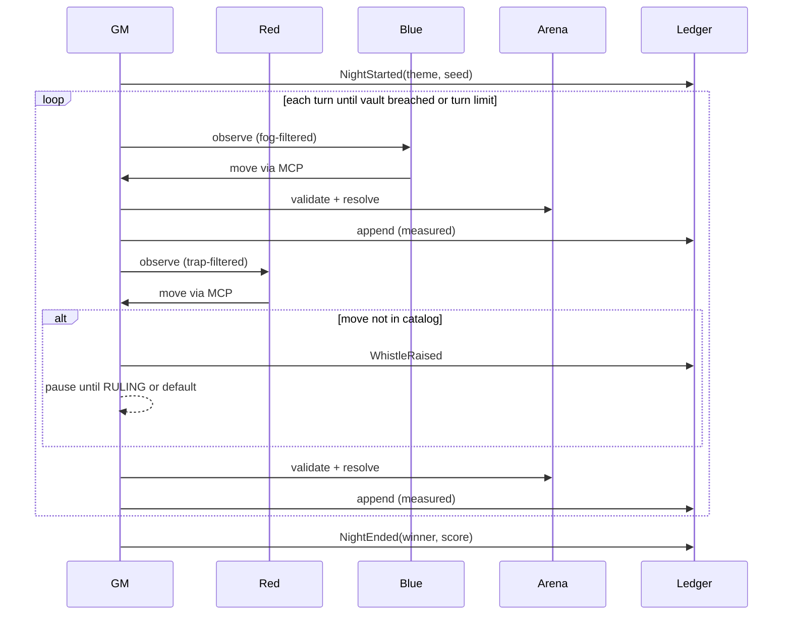

# Design Document — Ward & Wraith MVP

## Overview
A single Go binary hosts a deterministic Arena, a Game Master (GM) that brokers all agent traffic, a SAR-lite agent runtime, an append-only ledger, an evolution loop, a human referee surface, and a web UI streaming the game live. LLM agents act only through MCP tools served by the GM.

## Architecture



### Night sequence



## Components and Interfaces

### arena
- `type World struct` — nodes, edges, vulnerabilities, traps, actor positions, RNG seeded per night.
- `func (w *World) Apply(m Move) (Outcome, error)` — pure function of state + move; never reads time.
- `func (w *World) ViewFor(team Team) View` — fog-of-war projection.

### manor
- Static map: ~14 nodes over 3 floors + cellar + annex + vault.
- `Vulnerability{ID, Node, Class, ExploitMove, RealMeaning, ThemedLabel}`.
- Example entries: `exposed-admin-port` at `floor2.window`, `hardcoded-key` at `porch.mat`, `debug-endpoint` at `cellar.passage`.

### sar (SAR-lite)
```go
type Manifest struct {
    ID        AgentID
    Team      Team        // red | blue | neutral
    Role      Role        // scout, breacher, persister | watcher, analyst, responder | coach | narrator | caster
    Persona   string
    Allowed   []MoveType
    Budget    Budget      // tokens, moves per night
    Playbook  PlaybookRef // team + version
}
type State int // Registered, Ready, Active, Suspended, Retired
type Envelope struct {
    From, To AgentID; Night, Turn int
    Type     EnvType // move | observe | report
    Payload  json.RawMessage; TraceID string
}
```
Guardrails run in `gm` before resolution: allowed-move check → budget check → rate limit. Failures produce `Rejected` events.

### gm
- Turn loop, alternating Blue then Red per turn (Blue first so defense can react to fog reveals).
- Novelty check: a Red move is "novel" when it targets a vulnerability class not unlocked by any night so far, or chains moves in a pattern absent from the catalog → whistle.
- Win: Red occupies `vault` with an exfiltrate action. Turn limit default 20.

### ledger
```go
type Event struct {
    Seq      uint64; Night int; Turn int
    Actor    string          // agent id or "human" or "gm"
    Kind     EventKind
    Body     json.RawMessage
    Evidence Evidence        // measured | inferred
    PrevHash, Hash [32]byte  // sha256(PrevHash || canonical(event without Hash))
}
```
SQLite table with `seq` primary key; insert-only.

### crew
- One goroutine per agent per turn; prompt = persona + current promoted playbook + view + tool schema.
- Output must be a single MCP tool call; anything else = pass.

### evolve
- `Debrief(ledger, night) → Summary{team, losses, wins, novelMoves}`.
- `Coach(team, summary, playbook vN) → candidate vN+1` (LLM, mock in tests).
- `Gate(candidate)` plays K=3 fast simulated nights (mock-fast LLM settings) vs current + up to 3 hall-of-fame opponents; promote on majority win.
- Diff ratio computed line-wise; above `approval_threshold` (default 0.5) → referee APPROVE required.
- Elo: K-factor 32, both teams start at 1200.

### referee
- Actions: `PAUSE`, `RESUME`, `VETO`, `APPROVE`, `RULING{legal|illegal}`, `INJECT{scenario}` (INJECT is stretch).
- Defaults when absent for `referee_timeout` (default 30s in demo): novel move → illegal; large diff → hold; Elo spike → log only.

### commentary
- Narrator triggers: `NightStarted`, `NightEnded`, `Promoted`.
- Caster triggers: breach, trap sprung, vault reached, rejection streak.
- Each line `{Themed, Real}`; templated fallback when LLM unavailable.

### mcpserver
- Tools: `look`, `move(to)`, `probe(target)`, `act(kind, target)`, `report(text)`.
- Same server mode `wraith mcp` registered in `.kiro/settings/mcp.json` for development.

### web
- `GET /` manor canvas + controls (htmx); `GET /events` SSE; `POST /referee/{action}`; `GET /elo`.

## Data Models
- `nights/*.yaml`: `{id, name, themed_intro, unlocks: [move classes], real_meaning}`.
- `playbooks/<team>/v<N>.md`: front matter `{team, version, parent, created_night}` + body.

## Correctness Properties
These are the invariants to be checked with property-based tests (`pgregory.net/rapid`).

- **P1 Determinism** — For any seed and any move sequence, applying the sequence twice yields identical World state. *(Req 1.3, 4.4)*
- **P2 Reachability** — For any World and any move, an actor can only end on a node adjacent to its start or the same node. *(Req 3.1)*
- **P3 Fog integrity** — For any World, `ViewFor(blue)` contains no node Blue has not revealed, and `ViewFor(red)` contains no Blue trap. *(Req 1.4)*
- **P4 Guardrail closure** — For any manifest and any move whose type is not in `Allowed`, the GM rejects it and the World is unchanged. *(Req 2.4)*
- **P5 Ledger chain** — For any sequence of appended events, verification passes; flipping any byte of any stored event makes verification fail. *(Req 4.2)*
- **P6 Replay** — For any recorded night, replaying its ledger reproduces the final state hash. *(Req 4.4)*
- **P7 Promotion safety** — For any gate result without a majority win, the current playbook version is unchanged. *(Req 6.3)*
- **P8 Immutability** — For any promotion sequence, no existing playbook file content changes. *(Req 6.4)*
- **P9 Elo conservation** — For any match, the sum of rating deltas is zero. *(Req 6.5)*

## Error Handling
- Illegal or malformed agent output → `Rejected` event, turn counts as pass.
- LLM timeout/error → pass + `AgentFault` event; three consecutive faults → agent SUSPENDED for the night.
- Ledger write failure → night aborts (integrity over availability).
- Referee timeout → configured default applied and logged.

## Testing Strategy
- Unit tests per package; PBT for P1–P9; golden ledger replays in `testdata/`.
- Mock LLM provider with scripted policies (naive, greedy, cautious) so gates and Elo are testable without network.
- `wraith run-nights --demo` smoke test in CI.

## Open Decisions
- Bedrock model choice and per-night budget (cost cap for demo runs).
- Whether to also package the game as a **Kiro Crew app** (separate repo; nightly cron = literal "nights"; eligible for Best Kiro Crew App). Stretch.
